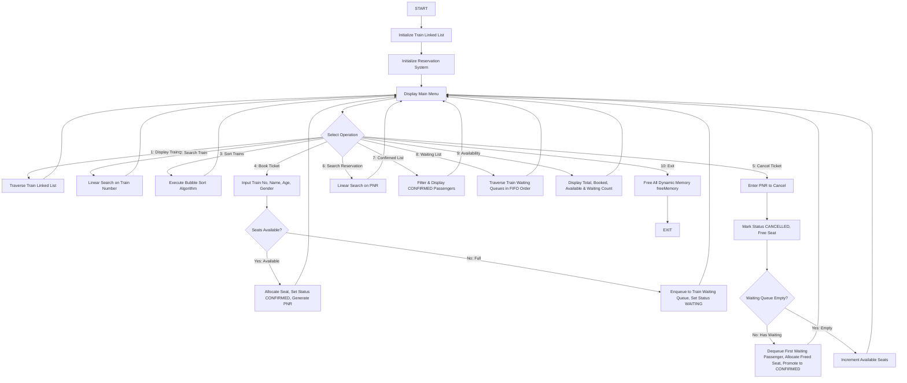

# Train Reservation Management System Using Data Structures
### *A DSA-Based Train Ticket Reservation and Management System*

> **Academic Level**: 2nd-Year B.Tech Computer Science and Engineering (Data Structures & Algorithms Mini Project)  
> **Course**: Data Structures and Algorithms (CSE Mini Project)  
> **Core Language**: C (Standard C99 / GCC)  
> **Primary Data Structures**: Singly Linked Lists, Queue (FIFO with Front & Rear pointers), Linear Search, Bubble Sort  
> **Core Objective**: Model a railway reservation system managing trains, passenger bookings, automated PNR generation, seat allocation, and FIFO waiting list promotion.  

---

## 1. Project Overview

The **Train Reservation Management System** is a modular, console-based application written in pure C that simulates the core operations of a railway ticket reservation counter.

Instead of relying on high-level databases or external libraries, the system implements core **Data Structures and Algorithms (DSA)** from first principles:
- **Singly Linked Lists** store dynamic directories of trains and passenger reservation records.
- **Queue (FIFO)** manages train-specific waiting lists using dedicated `front` and `rear` pointers.
- **Linear Search** provides lookup for trains by train number and passengers by PNR.
- **Bubble Sort** sorts trains dynamically by Train Number, Available Seats, or Ticket Fare.
- **Seat Allocation & Recycling** assigns unique seat numbers and automatically promotes the head of the waiting queue when a confirmed ticket is cancelled.

```
       ========================================================
                 TRAIN RESERVATION MANAGEMENT SYSTEM
       ========================================================
       1. Display All Trains
       2. Search Train
       3. Sort Trains
       4. Book Ticket
       5. Cancel Ticket
       6. Search Reservation
       7. Display Confirmed Reservations
       8. Display Waiting List
       9. Display Train Availability
       10. Exit
       ========================================================
```

---

## 2. Key Features

- **Dynamic Train Management (Linked List)**: Stores train number, train name, source, destination, total seats, available seats, fare, and a train-specific waiting queue.
- **Automated PNR Generation**: Generates unique, non-repeating PNR numbers starting from `1001` upwards.
- **Non-Duplicate Seat Allocation**: Tracks allocated seats via a dedicated seat map ($1 \le \text{seat} \le \text{totalSeats}$) to ensure no duplicate seat numbers are assigned.
- **FIFO Waiting List Queue**: When confirmed seats are exhausted, passengers are seamlessly enqueued into a waiting list queue.
- **Automated Cancellation & Promotion**: When a confirmed passenger cancels, their seat is freed and the first passenger in the waiting queue is automatically dequeued and promoted to `CONFIRMED`.
- **Manual Bubble Sort**: Sorts trains by Train Number, Available Seats (descending), or Fare (ascending) without using built-in library functions like `qsort()`.
- **Linear Search Retrieval**: Look up trains by train number or reservation records by unique PNR.
- **Defensive Input Handling**: Reads inputs using `fgets()` and `strtol()`, preventing crashes, buffer overflows, or infinite loops on invalid input.
- **Complete Memory Cleanup**: Traverses and frees all train nodes, passenger nodes, and waiting queue nodes using `freeMemory()` on exit.

---

## 3. Data Structures & System Architecture

### 3.1 Data Structures Mapping

| Feature | Data Structure / Algorithm | Role in Project | Time Complexity |
| :--- | :--- | :--- | :---: |
| **Train Records** | Singly Linked List (`Train*`) | Dynamic storage of train schedules and fares | $\mathcal{O}(n)$ |
| **Passenger Bookings** | Singly Linked List (`Passenger*`) | Central record of all confirmed, waiting, and cancelled bookings | $\mathcal{O}(n)$ |
| **Waiting List** | Queue (FIFO with `front` & `rear`) | Enqueues overflow passengers; dequeues on cancellation | $\mathcal{O}(1)$ |
| **Train Lookup** | Linear Search | Search train by train number | $\mathcal{O}(n)$ |
| **Reservation Lookup**| Linear Search | Search booking by PNR number | $\mathcal{O}(n)$ |
| **Train Sorting** | Bubble Sort | Sorts trains by Number, Available Seats, or Fare | $\mathcal{O}(n^2)$ |
| **Seat Map** | Array / Flag Mapping (`seatMap[]`) | Tracks and recycles physical seat assignments ($1 \dots \text{total}$) | $\mathcal{O}(\text{total})$ |
| **PNR Generation** | Auto-incrementing Integer Counter | Generates guaranteed unique PNR numbers | $\mathcal{O}(1)$ |

### 3.2 Simulated Train Schedule

> *Note: These trains, schedules, seat counts, and fares are simulated academic data for demonstration purposes.*

| Train No. | Train Name | Source | Destination | Total Seats | Fare (Rs.) |
|:---:|:---|:---|:---|:---:|:---:|
| **101** | Chennai Express | Chennai | Bangalore | 50 | 450.00 |
| **102** | Coastal Express | Chennai | Coimbatore | 40 | 350.00 |
| **103** | Intercity Express | Chennai | Madurai | 60 | 400.00 |
| **104** | Southern Express | Chennai | Trichy | 50 | 300.00 |
| **105** | City Express | Chennai | Salem | 3 | 250.00 |

*(Train 105 is configured with 3 seats to facilitate easy demonstration of the waiting list and cancellation promotion during vivas).*

---

## 4. System Flowchart



---

## 5. Project Directory Structure

```
Train-Reservation-System/
│
├── src/
│   └── main.c              # Complete C source code (Linked lists, Queue, Bubble sort, Menu)
│
├── build.bat               # One-click Windows batch script to compile with GCC
├── run.bat                 # One-click Windows batch script to run the program
│
├── screenshots/            # Directory reserved for project demo screenshots
│
├── .gitignore              # Ignores build artifacts (*.exe, *.o, etc.)
│
└── README.md               # Academic report, documentation, flowchart, and 25 viva questions
```

---

## 6. How to Compile and Run

### Prerequisites
- Any standard C compiler: **GCC** (MinGW / MSYS2 / Linux GCC / Clang).

### Option A: Using One-Click Batch Scripts (Windows)
1. Double-click `build.bat` to compile `train_reservation.exe`.
2. Double-click `run.bat` to launch the application.

### Option B: Using the Command Line
```powershell
# 1. Compile using GCC:
gcc -Wall -Wextra -std=c99 src/main.c -o train_reservation.exe

# 2. Run the executable:
.\train_reservation.exe
```

---

## 7. Sample Execution Outputs

### Test Case 1: Confirmed Ticket Booking
```text
Enter Train Number to book: 101
Enter Passenger Name: Rahul Sharma
Enter Passenger Age: 21
Enter Gender (Male/Female/Other): Male

========================================================
                    BOOKING CONFIRMED                   
========================================================
PNR Number  : 1001
Passenger   : Rahul Sharma
Age / Gender: 21 / Male
Train No    : 101 (Chennai Express)
Route       : Chennai -> Bangalore
Seat No     : 1
Fare        : Rs. 450.00
Status      : CONFIRMED
========================================================
```

### Test Case 2: Waiting List Booking (When Train is Full)
*(When Train 105 reaches its capacity of 3 seats):*
```text
Enter Train Number to book: 105
Enter Passenger Name: Ananya
Enter Passenger Age: 20
Enter Gender (Male/Female/Other): Female

========================================================
                    WAITING LIST                        
========================================================
No confirmed seats available on Train 105.
Passenger added to Waiting Queue (FIFO).

PNR Number  : 1004
Passenger   : Ananya
Train No    : 105 (City Express)
Status      : WAITING
Waiting Pos : 1
========================================================
```

### Test Case 3: Ticket Cancellation & Automated FIFO Waiting List Promotion
```text
Enter PNR Number to cancel: 1002

========================================================
              TICKET CANCELLED SUCCESSFULLY             
========================================================
PNR Number  : 1002
Passenger   : Vikram
Seat Freed  : 2
Status      : CANCELLED
========================================================

>>> WAITING LIST PROMOTION (FIFO QUEUE) <<<
A seat opened up! The next passenger in the waiting queue has been promoted:
Promoted PNR   : 1004
Passenger Name : Ananya
Train Number   : 105
Assigned Seat  : 2
New Status     : CONFIRMED
Remaining Wait : 0 passengers
========================================================
```

### Test Case 4: Search Reservation by PNR
```text
Enter PNR Number to search: 1004

========================================================
                  RESERVATION DETAILS                   
========================================================
PNR Number    : 1004
Passenger     : Ananya
Age / Gender  : 20 / Female
Train Number  : 105 City Express
Route         : Chennai -> Salem
Seat Number   : 2
Fare          : Rs. 250.00
Status        : CONFIRMED
========================================================
```

### Test Case 5: Display Train Availability
```text
Enter Train Number to check availability: 105

========================================================
               TRAIN SEAT AVAILABILITY                  
========================================================
Train Number    : 105
Train Name      : City Express
Route           : Chennai -> Salem
Total Seats     : 3
Booked Seats    : 3
Available Seats : 0
Waiting List    : 0
Status          : WAITING LIST ONLY
========================================================
```

---

## 8. Algorithmic Complexity Analysis

| Operation | Function / Routine | Best Case | Average Case | Worst Case | Space Complexity |
| :--- | :--- | :---: | :---: | :---: | :---: |
| **Add Train Node** | `addTrain()` | $\mathcal{O}(1)$ | $\mathcal{O}(n)$ | $\mathcal{O}(n)$ | $\mathcal{O}(1)$ |
| **Search Train** | `findTrain()` (Linear Search) | $\mathcal{O}(1)$ | $\mathcal{O}(n)$ | $\mathcal{O}(n)$ | $\mathcal{O}(1)$ |
| **Search Reservation**| `findPassenger()` (Linear Search)| $\mathcal{O}(1)$ | $\mathcal{O}(m)$ | $\mathcal{O}(m)$ | $\mathcal{O}(1)$ |
| **Enqueue Waiting** | `enqueueWaitingPassenger()` | $\mathcal{O}(1)$ | $\mathcal{O}(1)$ | $\mathcal{O}(1)$ | $\mathcal{O}(1)$ |
| **Dequeue Waiting** | `dequeueWaitingPassenger()` | $\mathcal{O}(1)$ | $\mathcal{O}(1)$ | $\mathcal{O}(1)$ | $\mathcal{O}(1)$ |
| **Bubble Sort** | `sortTrains()` | $\mathcal{O}(n)$ | $\mathcal{O}(n^2)$ | $\mathcal{O}(n^2)$ | $\mathcal{O}(n)$ |
| **Allocate Seat** | `allocateSeat()` | $\mathcal{O}(1)$ | $\mathcal{O}(S)$ | $\mathcal{O}(S)$ | $\mathcal{O}(1)$ |
| **Cancel & Promote** | `cancelTicket()` | $\mathcal{O}(1)$ | $\mathcal{O}(m)$ | $\mathcal{O}(m)$ | $\mathcal{O}(1)$ |

*Where $n = \text{number of trains}$, $m = \text{number of passenger records}$, and $S = \text{total seats per train}$.*

---

# DSA MINI PROJECT REPORT CONTENT

### 1. Title
**Train Reservation Management System Using Data Structures**  
*A DSA-Based Ticket Booking, Seat Allocation, and Waiting List Management System*

### 2. Abstract
Ticketing logistics in modern transportation systems require reliable, deterministic data storage and fair queuing protocols. This project presents a console-based Train Reservation Management System engineered in standard C. By applying linked lists for trains and passenger records, dedicated FIFO queues for waiting-list passengers, linear search algorithms for record lookups, and a manual Bubble Sort for train schedule organization, the system models real-world passenger booking, seat allocation, cancellation, and automated waiting-list promotion without external database dependencies.

### 3. Introduction
Data structures form the architectural backbone of computer science. Understanding how linear data structures—such as linked lists and queues—model physical scenarios is a core objective of the 2nd-year B.Tech CSE curriculum. This project demonstrates how fundamental memory allocation techniques and FIFO queuing principles can be synthesized into an interactive railway ticket reservation system.

### 4. Problem Statement
Manual or static tabular booking systems are prone to human errors, duplicate seat assignments, and unfair handling of ticket cancellations. A software solution is required to:
- Guarantee unique PNR identification.
- Prevent duplicate seat allocation.
- Manage waiting passengers strictly in First-In, First-Out (FIFO) sequence.
- Automatically reallocate freed seats to waiting passengers upon cancellation.

### 5. Objectives
- Implement dynamic linked list structures for managing train directories and passenger records.
- Implement a Queue with front and rear pointers to maintain waiting-list passengers.
- Guarantee unique PNR generation and non-duplicate seat numbering.
- Implement an automated seat-reassignment pipeline upon cancellation.
- Implement manual sorting (Bubble Sort) and searching (Linear Search) algorithms.
- Enforce robust input validation and dynamic memory cleanup.

### 6. Existing System
- **Static Array Systems**: Fixed sizes cause either memory waste or overflow when bookings exceed limits.
- **Manual Counter Registers**: High latency, human error, duplicate ticket issues, and lack of automated queue promotion.
- **Overcomplicated Database Systems**: Excessively heavy for educational DSA demonstration and difficult to analyze at the pointer level.

### 7. Proposed System
- Dynamic Linked List architecture allocating memory on demand.
- Dedicated FIFO queue per train for transparent waiting list promotion.
- Zero external libraries or database engines; purely implemented in C.
- Immediate automated promotion of waiting passengers upon confirmed ticket cancellation.

### 8. System Modules
1. **Train Management Module**: Initializes and displays train routes, seat capacities, and fares.
2. **Ticket Booking Module**: Validates availability, generates PNR, and assigns seats.
3. **Waiting List Queue Module**: Handles `enqueue` when capacity is full and `dequeue` upon cancellation.
4. **Cancellation & Promotion Engine**: Frees seats and automatically promotes waiting passengers.
5. **Search & Lookup Module**: Linear search on trains by number and passengers by PNR.
6. **Sorting Module**: Bubble Sort by Train Number, Available Seats, or Fare.
7. **Memory Deallocation Module**: Traverses all nodes to prevent memory leaks.

### 9. Data Structures Used
- `Train` (Singly Linked List node): Train metadata and embedded `WaitingQueue`.
- `Passenger` (Singly Linked List node): Booking details, seat number, and status.
- `WaitingNode` & `WaitingQueue` (Queue): Linked FIFO queue with `front`, `rear`, and `count`.
- `seatMap[]` (Array): Tracks allocated physical seat numbers from $1$ to $\text{totalSeats}$.

### 10. Algorithms Used
- **FIFO Queue Enqueue / Dequeue**: $\mathcal{O}(1)$ insertion at rear and deletion at front.
- **Linear Search**: Sequential scan comparing target values with list keys.
- **Bubble Sort**: Iterative pairwise comparison and swapping to order trains.

### 11. System Flow
1. Initialize train linked list with default simulated trains.
2. Display interactive command-line interface.
3. User selects an action:
   - **Booking**: Check availability $\to$ allocate seat or enqueue to waiting queue.
   - **Cancellation**: Free seat $\to$ check waiting queue $\to$ dequeue and promote if available.
   - **Search / Sort**: Traverse or sort linked list.
4. On program exit, all allocated dynamic memory is freed.

### 12. Pseudocode
```
Algorithm BookTicket(TrainNumber, Name, Age, Gender):
    train = FindTrain(TrainNumber)
    if train is NULL:
        return "Train not found"

    pnr = GeneratePNR()
    if train.availableSeats > 0:
        seat = AllocateSeat(train)
        train.availableSeats = train.availableSeats - 1
        passenger = CreatePassenger(pnr, Name, Age, Gender, seat, "CONFIRMED")
        AddPassengerRecord(passenger)
        return "Booking Confirmed"
    else:
        EnqueueWaiting(train.waitingQueue, pnr, Name, Age, Gender)
        passenger = CreatePassenger(pnr, Name, Age, Gender, 0, "WAITING")
        AddPassengerRecord(passenger)
        return "Added to Waiting Queue"

Algorithm CancelTicket(PNR):
    passenger = FindPassenger(PNR)
    if passenger is NULL or passenger.status == "CANCELLED":
        return "Invalid ticket"

    train = FindTrain(passenger.trainNumber)
    passenger.status = "CANCELLED"
    FreeSeat(train, passenger.seatNumber)
    train.availableSeats = train.availableSeats + 1

    if not IsQueueEmpty(train.waitingQueue):
        promoted = DequeueWaiting(train.waitingQueue)
        newSeat = AllocateSeat(train)
        train.availableSeats = train.availableSeats - 1
        waitingPassenger = FindPassenger(promoted.pnr)
        waitingPassenger.seatNumber = newSeat
        waitingPassenger.status = "CONFIRMED"
        return "Cancelled and Waiting Passenger Promoted"
```

### 13. Implementation
Implemented in pure C (`src/main.c`) adhering to ISO C99 standards. Functions are structured modularly with clear separation of concerns between data structures, business logic, and UI display.

### 14. Complexity Analysis
- Enqueue / Dequeue: $\mathcal{O}(1)$ time, $\mathcal{O}(1)$ space.
- Linked list searches: $\mathcal{O}(n)$ time.
- Bubble Sort: $\mathcal{O}(n^2)$ time in worst case, $\mathcal{O}(n)$ space for pointer array.

### 15. Advantages
- Pure algorithmic demonstration without external software dependencies.
- Completely dynamic memory allocation eliminates fixed array bounds.
- Guaranteed fairness in waiting list allocation via FIFO ordering.
- Zero memory leaks upon exit.

### 16. Limitations
- Single-session in-memory storage (resets on program termination).
- Single-seat booking per transaction (group bookings require multiple entries).
- Console interface without graphical visualization.

### 17. Future Enhancements
- File I/O persistence (`trains.dat` and `passengers.dat`).
- Integration of a database backend (e.g., SQLite).
- Multi-seat family reservations with coach allotment.
- Graphical user interface using GTK, Raylib, or web frontend.

### 18. Conclusion
The Train Reservation Management System fulfills all technical and academic requirements of a 2nd-year B.Tech CSE Data Structures and Algorithms mini-project. It illustrates the real-world utility of linked lists, queues, linear search, and bubble sort in solving a practical engineering and logistics problem.

### 19. References
1. Cormen, T. H., Leiserson, C. E., Rivest, R. L., & Stein, C. (2009). *Introduction to Algorithms* (3rd ed.). MIT Press.
2. Kernighan, B. W., & Ritchie, D. M. (1988). *The C Programming Language* (2nd ed.). Prentice Hall.
3. Tenenbaum, A. M., Langsam, Y., & Augenstein, M. J. (1990). *Data Structures Using C*. Prentice Hall.

---

## 9. Comprehensive Viva Preparation (25 Questions & Model Answers)

#### Q1. Why did you choose a Linked List instead of an Array for train and passenger records?
**Ans:** Arrays have a fixed size declared at compile time, leading to memory waste if underutilized or buffer overflows if bookings exceed capacity. A linked list allocates memory dynamically on demand at runtime ($\mathcal{O}(1)$ node insertion), accommodating any number of passengers.

#### Q2. Why did you use a Queue for the waiting list?
**Ans:** A waiting list requires strict First-In, First-Out (FIFO) fairness. The first passenger who joined the waiting list must be the first one to receive a seat when a confirmed ticket is cancelled. A queue naturally guarantees this order.

#### Q3. What is FIFO?
**Ans:** FIFO stands for **First-In, First-Out**. In a FIFO data structure, the element inserted first is the first element to be removed.

#### Q4. What are `front` and `rear` pointers in a Queue?
**Ans:** `front` points to the first element in the queue (where deletions/dequeues take place), and `rear` points to the last element in the queue (where insertions/enqueues take place).

#### Q5. How does the waiting list promotion work when a ticket is cancelled?
**Ans:** When a confirmed ticket is cancelled, its assigned seat is marked free. The system then inspects the train's waiting queue: if not empty, it calls `dequeueWaitingPassenger()` to remove the first waiting passenger, assigns them the newly freed seat, and updates their reservation status to `CONFIRMED`.

#### Q6. What is the time complexity of enqueuing and dequeuing in your Queue?
**Ans:** Both `enqueue` and `dequeue` run in $\mathcal{O}(1)$ time because we maintain explicit `front` and `rear` pointers, avoiding any need to traverse the queue.

#### Q7. What is Linear Search and where is it used in your project?
**Ans:** Linear search is a sequential search algorithm that inspects each element of a list one by one until the target key is found or the end is reached. We use it to find trains by `trainNumber` and reservations by `pnr`.

#### Q8. Why did you choose Linear Search instead of Binary Search?
**Ans:** Binary Search requires random access ($\mathcal{O}(1)$ indexing) over a sorted collection, which is not directly supported by singly linked lists. Traversing a linked list to find midpoints takes $\mathcal{O}(n)$, neutralizing Binary Search's advantages. Linear Search is natural and optimal for singly linked lists of moderate size.

#### Q9. What is Bubble Sort?
**Ans:** Bubble Sort is an elementary comparison-based sorting algorithm that repeatedly steps through the list, compares adjacent elements, and swaps them if they are in the wrong order until the collection is sorted.

#### Q10. What is the time and space complexity of Bubble Sort?
**Ans:** 
- **Time Complexity**: Worst and Average case $\mathcal{O}(n^2)$; Best case $\mathcal{O}(n)$ if already sorted.
- **Space Complexity**: $\mathcal{O}(1)$ auxiliary space for in-place swapping.

#### Q11. How do you prevent duplicate seat numbers from being assigned?
**Ans:** Each train maintains an integer seat allocation array `seatMap[]`. When allocating a seat, the system searches for the lowest index where `seatMap[i] == 0`, marks it as `1` (booked), and assigns seat `i`. When cancelled, `seatMap[freedSeat] = 0`. This guarantees no two passengers ever share a seat number.

#### Q12. What is a PNR number and how is it generated?
**Ans:** PNR stands for **Passenger Name Record**. In our system, it is generated automatically by an incrementing counter starting at `1001` (`nextPNR++`), ensuring every reservation receives a globally unique identifier without manual user input.

#### Q13. What happens when a user attempts to book a train that is already full?
**Ans:** The system checks `availableSeats`. If it is $0$, instead of rejecting the passenger, it enqueues them into the train's FIFO waiting queue with status `WAITING` and reports their waiting list position.

#### Q14. What happens if a passenger cancels a ticket that is already on the waiting list?
**Ans:** The ticket's status is changed to `CANCELLED`, but no seat is freed because waiting passengers hold no seat.

#### Q15. How do you handle invalid inputs such as characters entered at numeric prompts?
**Ans:** We use a safe input helper that reads the raw line into a buffer using `fgets()` and parses it using `strtol()`. If non-numeric characters are detected, it rejects the input and prompts again without getting trapped in an infinite loop.

#### Q16. How is memory management handled in C for this project?
**Ans:** Every node created via `malloc()` during execution is tracked. When the user exits (Option 10), `freeMemory()` traverses and frees all passenger nodes, train nodes, and waiting queue nodes to prevent memory leaks.

#### Q17. What is the difference between a Singly Linked List and a Doubly Linked List?
**Ans:** A singly linked list has only a `next` pointer allowing forward traversal. A doubly linked list has both `prev` and `next` pointers, allowing bidirectional traversal at the cost of an extra pointer per node.

#### Q18. Can a Stack be used in a railway reservation system?
**Ans:** Yes. A stack (LIFO) could be used to implement an "Undo Cancellation" feature or track recently cancelled transactions, though it is not suitable for waiting lists where fairness (FIFO) is mandatory.

#### Q19. What are the main limitations of your project?
**Ans:** Data is stored in RAM only (no persistent database/file storage across application restarts), and it supports single-passenger bookings per transaction.

#### Q20. How would you extend this project into a production-grade system?
**Ans:** By adding persistent file/database storage (PostgreSQL/SQLite), user authentication, payment gateway integration, multi-berth coach allocation (Lower, Middle, Upper), and a responsive web/mobile frontend.

#### Q21. Why did you use an array of pointers to sort the linked list in Bubble Sort?
**Ans:** Sorting linked lists directly by swapping nodes requires manipulating multiple pointer links, which can be error-prone. Transferring node pointers to a temporary array allows straightforward Bubble Sort swapping, after which the linked list links are re-stitched in sorted order in $\mathcal{O}(n)$ time.

#### Q22. What happens if a user enters a non-existent PNR to cancel?
**Ans:** Linear search traverses the passenger list. If no matching node is found, it reports `ERROR: No reservation found with PNR <num>` without crashing.

#### Q23. What status values can a ticket have in your system?
**Ans:** `CONFIRMED`, `WAITING`, and `CANCELLED`.

#### Q24. What is the advantage of dynamic memory allocation over static memory allocation?
**Ans:** Dynamic memory allocation permits run-time flexibility; memory is acquired only when needed and can be returned to the OS via `free()`, whereas static allocation fixes array limits at compile time.

#### Q25. How do you calculate Booked Seats for a train?
**Ans:** $$\text{Booked Seats} = \text{Total Seats} - \text{Available Seats}$$

---

## 10. Screenshot Checklist for Viva / Lab Report

Capture screenshots of these 12 operations when preparing your academic report:
1. **Main Menu**: Screen showing all 10 options.
2. **Display All Trains**: Option 1 showing the formatted table of trains.
3. **Search Train**: Option 2 searching for Train 101.
4. **Sort Trains**: Option 3 sorting trains by fare.
5. **Successful Booking**: Option 4 booking a confirmed seat.
6. **Multiple Reservations**: Display confirmed reservations (Option 7).
7. **Waiting List Booking**: Booking on Train 105 until capacity (3 seats) is full, showing the 4th passenger added to the waiting list.
8. **Display Waiting List**: Option 8 showing waiting passengers in queue order.
9. **Ticket Cancellation**: Option 5 cancelling a confirmed ticket.
10. **Waiting Promotion**: Screen showing the automatic promotion of the waiting passenger.
11. **Train Availability**: Option 9 checking updated train stats.
12. **Exit & Cleanup**: Option 10 confirming memory deallocation and clean exit.

---

## 11. Academic Attribution
This project is developed for educational purposes under the 2nd-Year B.Tech Computer Science and Engineering curriculum.
All rights reserved © 2026.
